 

  

### 🚀 Featured projects

| Project | Stack | What it does |
|---|---|---|
| [**quic-ssh**](https://github.com/VLOD-ZDOV/quic-ssh) | Rust | SSH over QUIC with TCP fallback. Sessions survive network drops |
| [**YAFM**](https://github.com/VLOD-ZDOV/YAFM) | Kotlin | Android file manager: local, root, SFTP, SMB, FTP |
| [**VulkanMod-Next**](https://github.com/VLOD-ZDOV/VulkanMod-Next) | Java · GLSL | Vulkan renderer for Minecraft |
| [**vless-extractor**](https://github.com/VLOD-ZDOV/vless-extractor) | Go | Pulls vless:// links from subscriptions and configs |
| [**CappyChess0**](https://github.com/VLOD-ZDOV/CappyChess0) | Python | AlphaZero-style engine for Capablanca chess |
| [**Selabt**](https://github.com/VLOD-ZDOV/Selabt) · [**Apar-tui**](https://github.com/VLOD-ZDOV/Apar-tui) | Rust | TUI managers for SELinux and AppArmor |

### 🐍 Contribution graph

<picture>
  <source media="(prefers-color-scheme: dark)" srcset="https://raw.githubusercontent.com/VLOD-ZDOV/VLOD-ZDOV/output/snake-dark.svg"/>
  
</picture>

